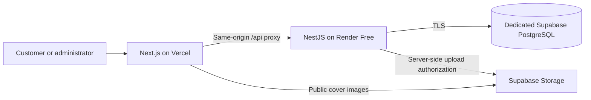

# BookStore · Node.js Full Stack

A book commerce portfolio with a **NestJS API, Next.js storefront and admin dashboard**, backed by PostgreSQL and Supabase Storage. Browse books, search the catalog, manage a cart and place a demo cash-on-delivery order that is actually persisted.

[](https://github.com/JasonTM17/Ecommerce_BookStore_NodeJS/actions/workflows/node.yml)
[](https://bookstore-node-web.vercel.app/)
[](LICENSE)

**[Open the demo](https://bookstore-node-web.vercel.app/)** · [Tiếng Việt](README_VN.md) · [Production check](docs/production-check.md) · [API route inventory](backend-node/docs/api-parity.md)


## See the shopping flow

Real production browser captures: **catalog → search → book details → cart → COD checkout → saved order → order history**. The GIF uses captured keyframes with edited pacing; it is not a loading-speed benchmark. The checkout shown uses a synthetic demo account and does not involve a real payment or shipment.


## Screens

| Live catalog | Book details |
| --- | --- |
|  |  |

| Flash sale | Admin dashboard |
| --- | --- |
|  |  |

<details>
<summary>Mobile layout and persisted checkout</summary>

<p>
  
  
</p>


</details>

Captured on **30 October 2026** from the deployed Node.js application. Prices, stock, coupons, reviews and sales counters in the demo dataset are illustrative, not commercial activity. [Asset provenance and regeneration](docs/portfolio/README.md).

## Features and engineering

- **Catalog:** search, categories, publisher filters, sorting, pagination, stock and related books. The live API returned **100 active products** during the latest check.
- **Customer journey:** login, persistent cart, server-calculated checkout totals, cash-on-delivery orders and owner-scoped order reads.
- **Authentication:** JWT access tokens, refresh-token rotation, bcrypt password hashing and role-based access control for customer, manager and admin routes.
- **Checkout consistency:** database transactions, pessimistic product locks and conditional stock updates; pricing uses the same transaction manager to avoid exhausting a small connection pool.
- **Administration:** dashboard, product/inventory screens, orders and users. Customer access to the admin orders API was denied with HTTP 403 in the live check.
- **Media:** dedicated Supabase Storage with MIME, size and upload-role validation. Original illustrative catalog covers are clearly described as demo artwork.
- **Verification:** unit tests, PostgreSQL integration regressions, frontend tests and CI. The route inventory distinguishes HTTP-tested routes from source-only implementations.

## Stack

| Layer | Technologies |
| --- | --- |
| Web | Next.js 16, React 19, TypeScript, Tailwind CSS |
| Client state | TanStack Query, Zustand |
| API | Node.js 24, NestJS 11, TypeORM 0.3, OpenAPI |
| Data and media | PostgreSQL, Supabase Database and Storage |
| Tests | Jest, real PostgreSQL integration tests, Vitest, Playwright |
| Deployment | Vercel storefront, Render Free Docker API, GitHub Actions |

## Architecture



The browser uses `/api`; Vercel forwards requests to the Node API. Database and Storage service credentials stay on the server. The hosted runtime disables schema synchronization.

## Run locally

Requirements: Docker with Compose. Copy the example environment file and replace both example values with generated local secrets:

```sh
cp .env.node.example .env.node
# Edit .env.node before starting the stack.
docker compose --env-file .env.node -f docker-compose.node.yml up --build
```

- Storefront: `http://localhost:3008`
- Node API: `http://localhost:8088/api`
- Swagger: `http://localhost:8088/api/docs`

The Compose database is a separate disposable local instance; schema synchronization is enabled only there. The stack does not automatically populate the hosted catalog. See the [backend guide](backend-node/README.md) for manual development, explicit schema setup, environment variables and demo seeding. Keep all `.env` files and demo passwords out of Git.

## Verify changes

```sh
cd backend-node
npm ci
npm run typecheck
npm test -- --runInBand
npm run build
# With the disposable test database configured:
npm run docker:db:up
npm run test:integration
```

```sh
cd frontend
npm ci
npm run lint
npm run test:run
npm run build
```

[Node CI](https://github.com/JasonTM17/Ecommerce_BookStore_NodeJS/actions/workflows/node.yml) runs backend typecheck/tests/build and frontend lint/tests/build. PostgreSQL integration tests and authenticated production checks are separate evidence; a green build does not establish every live feature. See the [dated production report](docs/production-check.md) for scope and limitations.

## Repository map

```text
backend-node/       NestJS API, entities, DTOs, tests and environment example
frontend/           Next.js storefront, customer account and admin interface
backend/            Preserved Spring Boot reference implementation
mobile/             Existing mobile workspace; not part of this web acceptance
scripts/            Operations helpers and showcase GIF encoder
docs/portfolio/     Production screenshots, GIF and capture notes
docker-compose.node.yml   Isolated local Node.js stack
```

## Demo boundaries

Render Free can sleep after 15 minutes without inbound traffic; the first API request may be slow. Public storefront helpers can show fixture data when an API request fails, times out or returns an empty collection. A visible product card alone is therefore not proof of database connectivity.

**VNPay, SMTP email delivery and live AI responses are not verified integrations in this demo.** VNPay is disabled in checkout until configured. Homepage marketing figures such as “10,000+” and “10K+ favorites” are template copy, not measured usage; the verified catalog count is 100. This is a portfolio demonstration, not a commercial storefront or a claim that every route is production-ready.

## Container packages

Versioned API and storefront Docker packages use the Node-specific `node-v0.1.0` release line. See [container packages and release verification](docs/container-packages.md) for pull commands, source labels, immutable digests and runtime configuration.

## Origin and license

Converted from [JasonTM17/Ecommerce_BookStore](https://github.com/JasonTM17/Ecommerce_BookStore), preserving its genuine upstream history at `ba500398213fb977540a23a62b8f4e511585a8f6`. Spring Boot source and historical documentation remain as references; this fork's active backend is `backend-node/`. New work uses actual commit dates. [Migration notes](docs/node-migration.md) · [MIT license](LICENSE).
