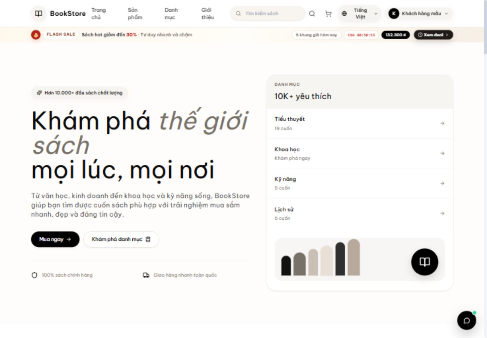
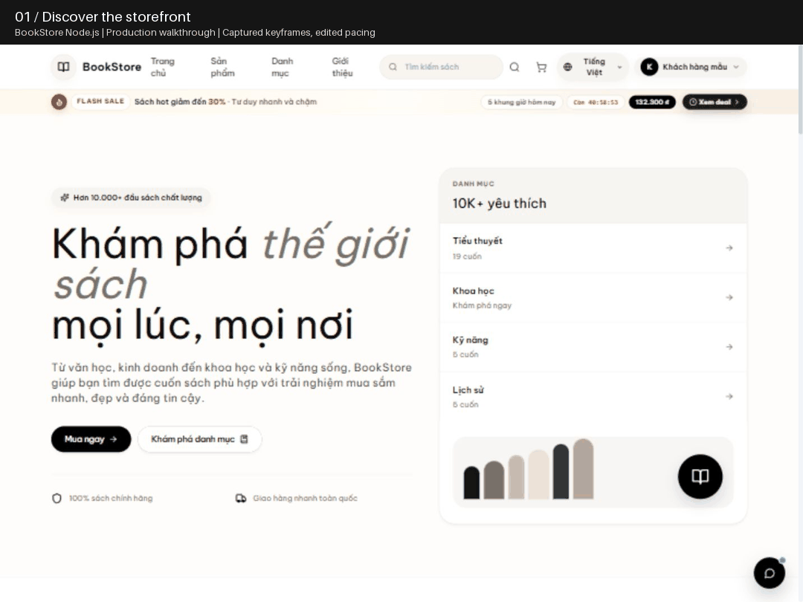
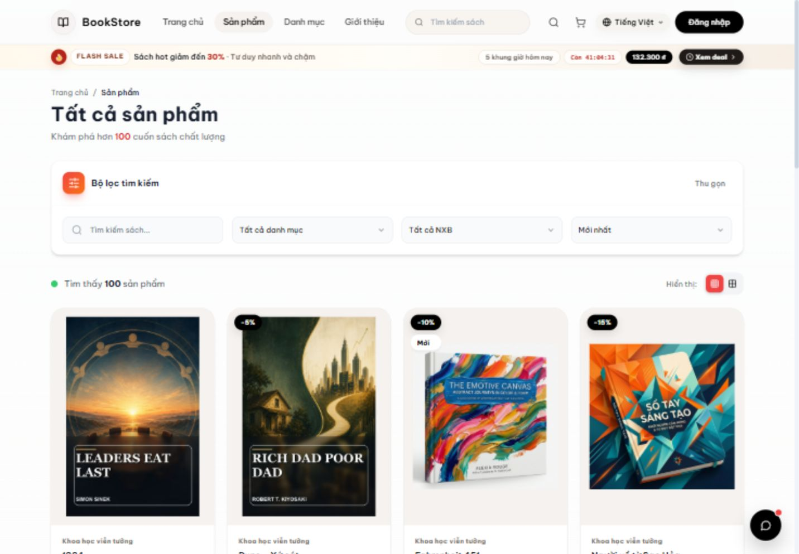
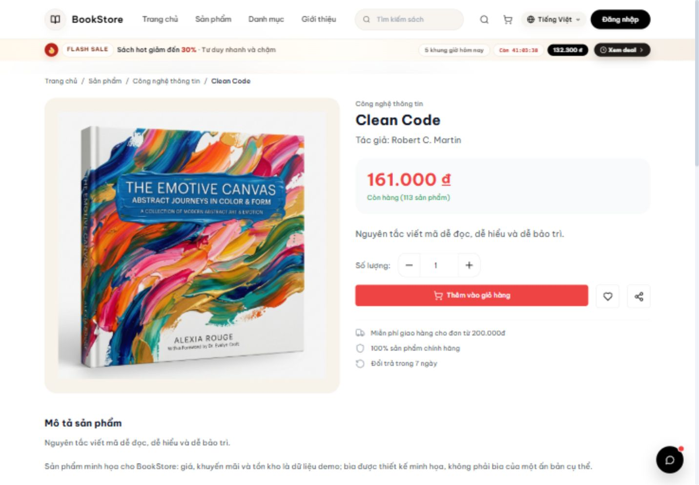
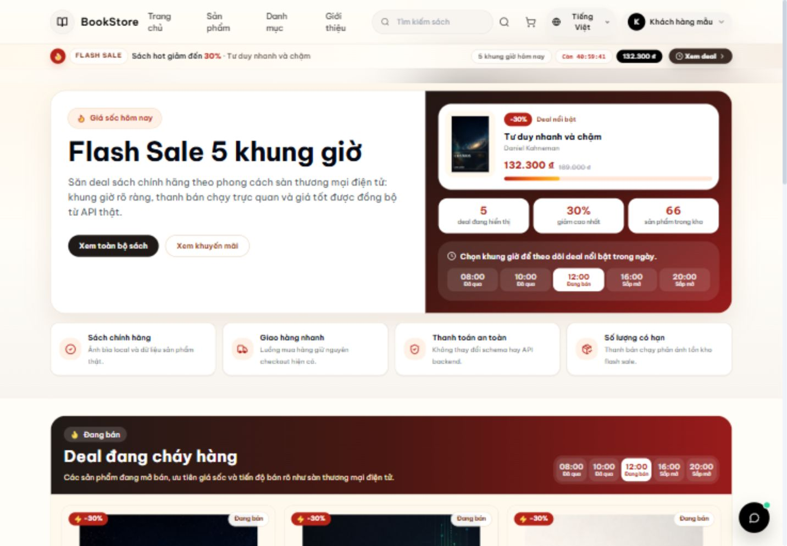
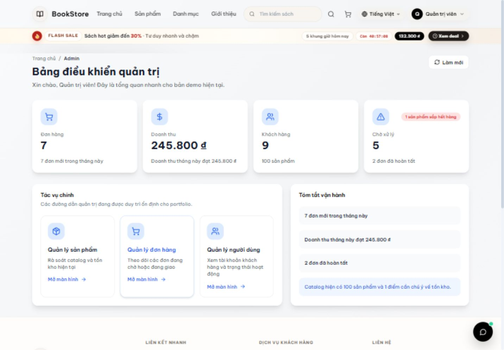
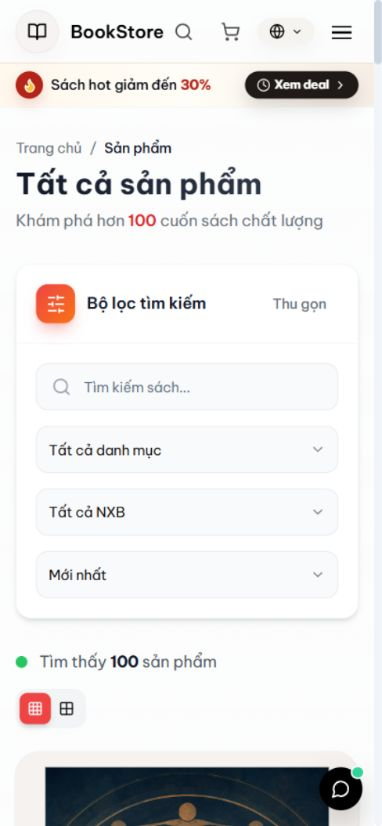
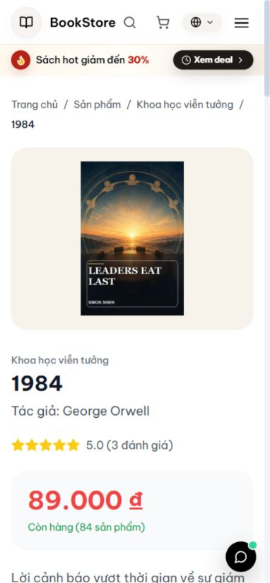
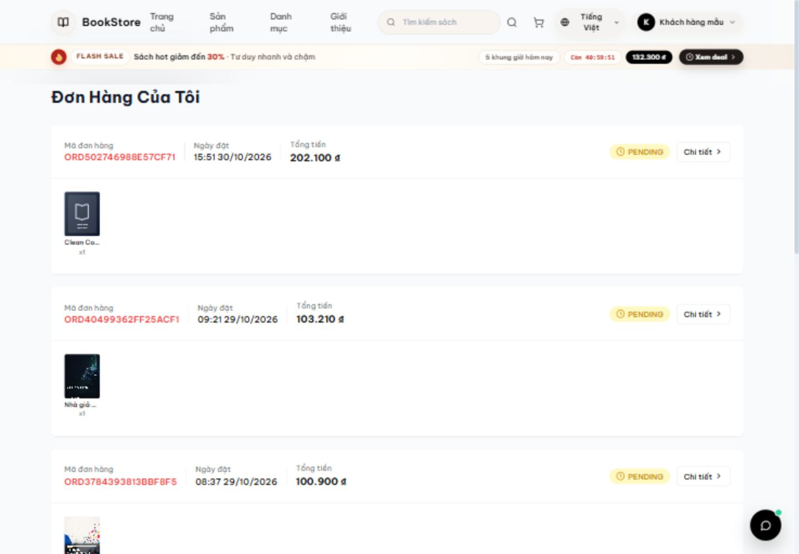
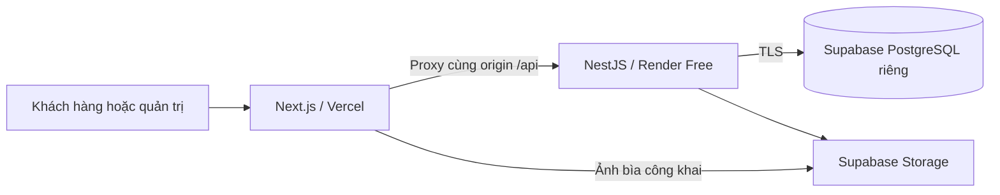

# BookStore · Node.js Full Stack

Dự án portfolio thương mại điện tử sách với **NestJS API, Next.js storefront và trang quản trị**, sử dụng PostgreSQL và Supabase Storage. Luồng demo cho phép tìm sách, thêm giỏ hàng, đặt đơn COD và xem lại đơn đã lưu thực tế.

[](https://github.com/JasonTM17/Ecommerce_BookStore_NodeJS/actions/workflows/node.yml)
[](https://bookstore-node-web.vercel.app/)

**[Trải nghiệm bản web](https://bookstore-node-web.vercel.app/)** · [English](README.md) · [Kiểm tra production](docs/production-check.md) · [Đối chiếu API](backend-node/docs/api-parity.md)



## Minh họa mua hàng

GIF ghép từ ảnh chụp các bước thao tác thật trên production: **catalog → tìm sách → chi tiết → giỏ hàng → checkout COD → tạo đơn → lịch sử đơn**. Nhịp hiển thị đã được biên tập, không dùng để đo tốc độ tải. Tài khoản và đơn hàng là dữ liệu mô phỏng; không thanh toán hoặc giao hàng thực tế.



## Giao diện

| Catalog | Chi tiết sách |
| --- | --- |
|  |  |

| Flash sale | Quản trị |
| --- | --- |
|  |  |

<details>
<summary>Xem giao diện mobile và đơn đã lưu</summary>

<p>
  
  
</p>



</details>

Ảnh chụp ngày **30/10/2026**, từ bản Node.js đã triển khai. Giá, tồn kho, đánh giá, lượt bán và khuyến mãi là dữ liệu demo, không phải hoạt động kinh doanh thật. Bìa là thiết kế minh họa, không đại diện cho một ấn bản thương mại. [Nguồn ảnh và cách tạo lại GIF](docs/portfolio/README.md).

## Chức năng và kỹ thuật

- **Catalog:** tìm kiếm, lọc danh mục/nhà xuất bản, sắp xếp, phân trang, xem tồn kho và sách liên quan. API production trả về **100 sản phẩm** trong lượt kiểm tra gần nhất.
- **Khách hàng:** đăng nhập, giỏ hàng lưu qua API, checkout tính giá phía server, đơn COD và lịch sử đơn theo chủ sở hữu.
- **Xác thực:** JWT, refresh token xoay vòng, bcrypt; phân quyền khách hàng, quản lý và quản trị viên.
- **Giao dịch:** khóa bản ghi sản phẩm, cập nhật tồn kho có điều kiện trong transaction; tính giá bằng cùng transaction manager để tránh nghẽn pool ít kết nối.
- **Quản trị:** dashboard, catalog/tồn kho, đơn hàng và người dùng. Kiểm tra thực tế: khách truy cập API đơn hàng quản trị nhận HTTP 403.
- **Lưu ảnh:** Supabase Storage riêng; kiểm tra MIME, kích thước và quyền tải lên. Thông tin bí mật chỉ ở phía server.
- **Kiểm thử:** Jest, PostgreSQL thật, Vitest, Playwright và GitHub Actions. Bảng đối chiếu API phân biệt rõ tuyến đã kiểm thử HTTP với tuyến mới có mã nguồn.

## Công nghệ và triển khai

| Thành phần | Công nghệ |
| --- | --- |
| Giao diện | Next.js 16, React 19, TypeScript, Tailwind CSS |
| Trạng thái | TanStack Query, Zustand |
| Backend | Node.js 24, NestJS 11, TypeORM 0.3, OpenAPI |
| Dữ liệu và tệp | PostgreSQL, Supabase Database/Storage |
| Kiểm thử | Jest, PostgreSQL integration, Vitest, Playwright |
| Hosting | Web trên Vercel, API Docker trên Render Free |



## Chạy local

Cần Docker và Compose. Sao chép tệp ví dụ rồi thay hai giá trị mẫu bằng bí mật local tự sinh:

```sh
cp .env.node.example .env.node
# Chỉnh .env.node trước khi khởi chạy.
docker compose --env-file .env.node -f docker-compose.node.yml up --build
```

Web tại `http://localhost:3008`, API tại `http://localhost:8088/api`, Swagger tại `http://localhost:8088/api/docs`. Database Compose là môi trường local riêng có thể tạo lại; không dùng cấu hình đồng bộ schema này cho dữ liệu production. Catalog hosted không được tự động seed khi chạy Compose.

[Tài liệu backend](backend-node/README.md) hướng dẫn chạy riêng, cấu hình môi trường, tạo schema và seed demo. Không commit `.env` hoặc mật khẩu. [README tiếng Anh](README.md#verify-changes) có lệnh kiểm thử đầy đủ.

## Kết quả kiểm tra và giới hạn

Lượt kiểm tra ngày 30/10/2026 đã quan sát: API/database UP, catalog 100 sách, tìm kiếm, 7 mã giảm giá công khai, đăng nhập khách/quản trị, thêm giỏ, checkout COD, đọc lại đơn đã lưu, chặn khách khỏi API quản trị và chặn truy cập đơn khi chưa đăng nhập. Catalog/chi tiết ở mobile 390px không tràn ngang và không có ảnh hỏng được phát hiện. [Báo cáo chi tiết](docs/production-check.md).

Render Free có thể ngủ sau 15 phút không nhận truy cập; lần gọi API đầu có thể chậm. Một số khối giao diện có dữ liệu dự phòng khi API lỗi, hết thời gian hoặc trả danh sách rỗng. Không dùng ảnh giao diện làm bằng chứng duy nhất rằng backend đang hoạt động.

VNPay, gửi email SMTP và AI provider **chưa được xác minh hoạt động thật**; VNPay bị vô hiệu trong checkout khi chưa cấu hình. Các dòng “10.000+ đầu sách”, “10K+ yêu thích” ở trang chủ là nội dung mẫu, không phải số liệu đo được. Đây là bản demo portfolio; không khẳng định mọi tính năng đã sẵn sàng vận hành thương mại.

## Cấu trúc và nguồn gốc

- `backend-node/`: NestJS API đang sử dụng, entities, DTOs và kiểm thử.
- `frontend/`: web khách hàng và quản trị bằng Next.js.
- `backend/`: mã Spring Boot gốc được giữ làm tham chiếu.
- `mobile/`: workspace mobile có sẵn, ngoài phạm vi kiểm tra web này.
- `docs/portfolio/`: ảnh/GIF production và ghi chú nguồn.
- `docker-compose.node.yml`: bộ dịch vụ Node.js local riêng.

Chuyển đổi từ [Ecommerce_BookStore](https://github.com/JasonTM17/Ecommerce_BookStore), giữ lịch sử Git gốc tại `ba500398213fb977540a23a62b8f4e511585a8f6`. Các commit mới dùng ngày thực hiện thật. Tài liệu Spring/Render cũ là lịch sử tham chiếu. [Ghi chú chuyển đổi](docs/node-migration.md) · [Giấy phép MIT](LICENSE).
